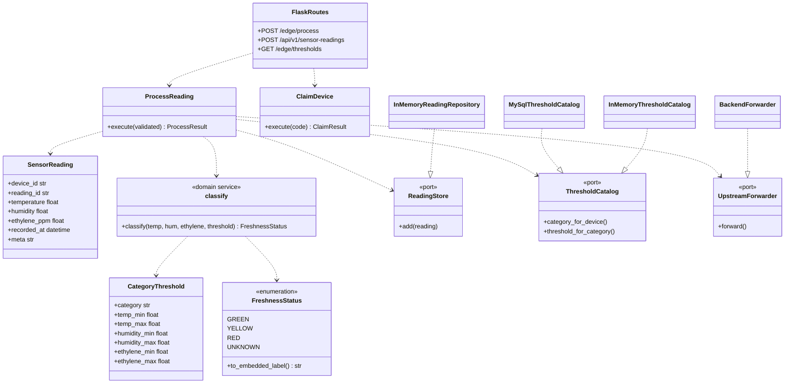
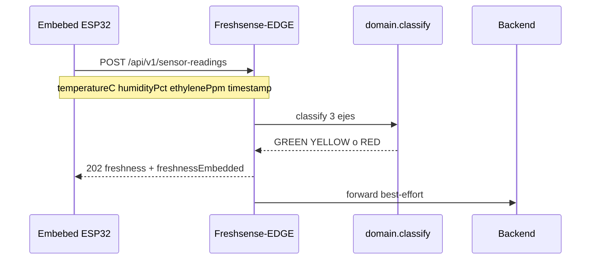

# Diagrama de clases — Freshsense-EDGE (DDD)

Bounded context **iot_ingestion**. El Edge recibe las lecturas del prototipo físico
[Embebed-System](https://github.com/1ASI0572-2620-8725/Embebed-System)
(`AM2302` + `MQ135` → `temperatureC`, `humidityPct`, `ethylenePpm`).

## Capas

| Capa | Carpeta | Piezas |
|---|---|---|
| Domain | `domain/` | `SensorReading`, `CategoryThreshold`, `FreshnessStatus`, `classify` |
| Application | `application/` | `ProcessReading`, `ClaimDevice`, `validation`, `ports` |
| Infrastructure | `infrastructure/` | MySQL, memoria, `BackendForwarder`, claim HTTP |
| Interfaces | `interfaces/` | Flask: `/edge/process` y `/api/v1/sensor-readings` |

## Dibujo

## Flujo con el ESP32 real

## Equivalencia con el embebido

| Edge | Embebed FS-FRUIT-1 |
|---|---|
| GREEN | FRESH |
| YELLOW | AT_RISK |
| RED | SPOILED |

Frutas (semilla): 0–8 °C, 90–95 %, 0–1 ppm.  
Devices sembrados: `esp32-freshsense-1` y `00000000-0000-0000-0000-000000000001`.
