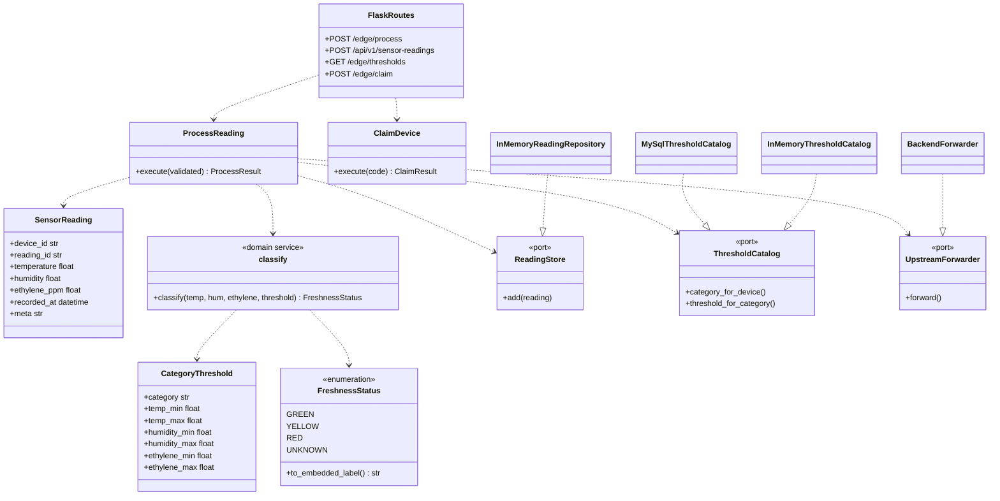
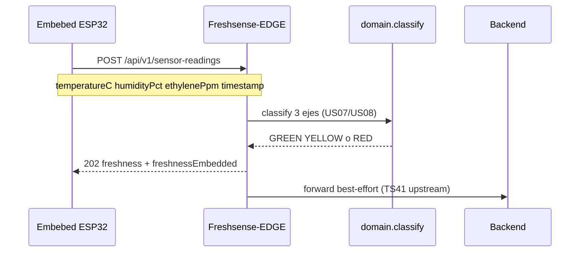

# Diagrama de clases — Freshsense-EDGE (DDD)

Bounded context **iot_ingestion** (informe:
[report](https://github.com/1ASI0572-2620-8725/report) — IoT Monitoring / EP02).

El Edge recibe las lecturas del prototipo físico
[Embebed-System](https://github.com/1ASI0572-2620-8725/Embebed-System)
(`AM2302` + `MQ135` → `temperatureC`, `humidityPct`, `ethylenePpm`)
por el contrato **TS41**: `POST /api/v1/sensor-readings`.

## Capas

| Capa | Carpeta | Piezas | Historias |
|---|---|---|---|
| Domain | `domain/` | `SensorReading`, `CategoryThreshold`, `FreshnessStatus`, `classify` | US06, US07, US08 |
| Application | `application/` | `ProcessReading`, `ClaimDevice`, `validation`, `ports` | US06, US31, TS41 |
| Infrastructure | `infrastructure/` | MySQL / memoria, `BackendForwarder`, claim HTTP | US08, US31 |
| Interfaces | `interfaces/` | Flask: `/edge/*` y `/api/v1/sensor-readings` | TS41, US31 |

## Dibujo

Versión PlantUML: [class-diagram.puml](class-diagram.puml).

## Flujo con el ESP32 real (US06 + TS41 + US07)

## Equivalencia con el embebido

| Edge | Embebed FS-FRUIT-1 | Informe |
|---|---|---|
| GREEN | FRESH | óptimo |
| YELLOW | AT_RISK | priorizar uso |
| RED | SPOILED | crítico |

Frutas (semilla): 0–8 °C, 90–95 %, 0–1 ppm.  
Devices: `esp32-freshsense-1` y `00000000-0000-0000-0000-000000000001`.
