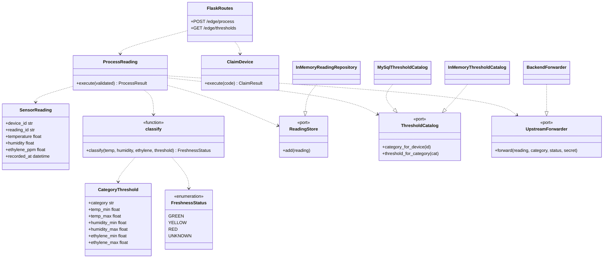

# Diagrama de clases — Freshsense-EDGE

Aplicación edge del bounded context **iot_ingestion**, en capas DDD. Recibe la lectura del nodo embebido ([Embebed-System](https://github.com/1ASI0572-2620-8725/Embebed-System)): temperatura, humedad y **etileno** (`ethylenePpm` del MQ135).

Equivalencia con el embebido FS-FRUIT-1:

| Edge | Embebido |
|---|---|
| GREEN | FRESH |
| YELLOW | AT_RISK |
| RED | SPOILED |

## Capas DDD

| Capa | Carpeta | Responsabilidad |
|---|---|---|
| Domain | `src/iot_ingestion/domain` | Entidades y reglas puras: `SensorReading`, `CategoryThreshold`, `classify` |
| Application | `src/iot_ingestion/application` | Casos de uso y puertos: `ProcessReading`, `ClaimDevice`, `validation`, `ports` |
| Infrastructure | `src/iot_ingestion/infrastructure` | Adaptadores: MySQL, memoria, HTTP al backend |
| Interfaces | `src/iot_ingestion/interfaces` | API Flask: `POST /edge/process`, umbrales, devices, claim |

El dominio no importa infraestructura ni Flask.

## Dibujo

## Flujo

1. El ESP32 (Embebed) envía `deviceId`, temperatura, humedad, `ethylenePpm` y tiempo.
2. `validation` acepta alias del embebido (`temperatureC`, `humidityPct`, `timestamp` ISO).
3. `ProcessReading` guarda la lectura, busca la categoría (p. ej. Frutas) y llama a `classify` con **tres ejes**.
4. Responde `202` con `freshness` y reenvía al backend (best-effort).

## Frutas (FS-FRUIT-1)

Semilla por defecto: temp 0–8 °C, humedad 90–95 %, etileno 0–1 ppm. Dispositivo demo `esp32-freshsense-1` → Frutas.
